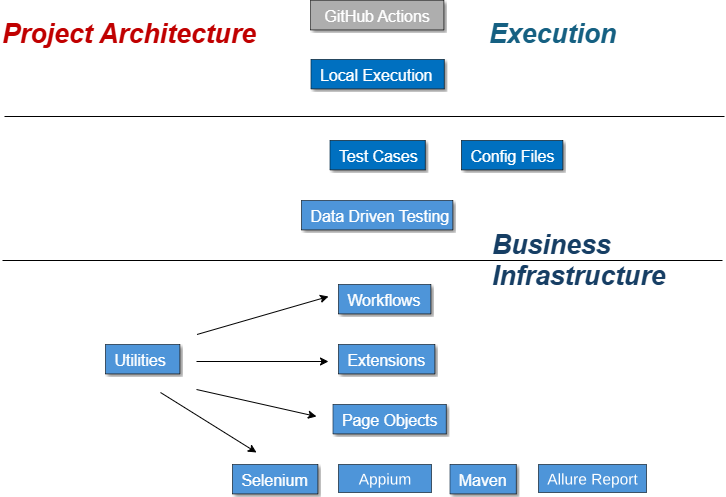

# Heirloom4life - Mobile E2E test automation

End-to-end test automation suite for the Heirloom4Life Android app, built with **Appium**, **Selenium**, **TestNG**, **Allure** reporting, run via **GitHub Actions**.

## About

Heirloom4Life is a mobile app for preserving personal stories (AI voice preservation). The suite drives the app on a real Android device through Appium.

---

## Project structure

```
MyFinancialPlan-project/
├── src/main/java/
│   ├── base/
│   │   ├── BasePage.java            # Test base: loads config, sets up/tears down the driver, takes failure screenshots
│   │   └── DriverFactory.java       # Creates the driver (android/ios/chrome/firefox/edge); scopes Android locators under CONTENT_ROOT and labels each lookup for Allure (calling page-object method + argument, masked if secret)
│   ├── com/heirloom4life/
│   │   └── SanityTest.java          # Main sanity E2E suite
│   ├── configuration/
│   │   └── config.properties        # Driver type, Appium server, app package/activity, wait time (placeholders resolved from .env)
│   ├── extensions/                  # Reusable test utilities
│   │   ├── WebActions.java          # UI interactions (click, type, select, upload, etc.)
│   │   ├── MobileActions.java       # Mobile gestures (adb-based scroll down)
│   │   └── Verifications.java       # Assertion helpers with Allure steps
│   ├── pageObjects/                 # Page Object Model (POM): Login, Navigation, Stories, Media, Memoir, Notification, Account
│   ├── workflows/                   # Multi-step user flows (login, sign out)
│   ├── scripts/
│   │   └── summarize-test.sh        # Parses the Surefire XML report and prints pass/fail/skip counts in CI
│   └── utilities/                   # Wait conditions, data providers & failure listener
│       ├── WaitForElement.java      # Wait conditions & synchronization
│       ├── DataUtil.java            # JSON test-data parser & .env placeholder resolver
│       └── TestData.java            # TestNG @DataProvider backed by testData.json
├── src/test/resources/
│   └── testData.json                # Data-driven test data
├── Suites/                          # TestNG suite XML files
│   └── Sanity.xml
├── .github/
│   ├── actions/
│   │   └── action.yml               # Composite action: runs summarize-test.sh and prints the suite's test summary
│   └── workflows/
│       └── E2E test.yml             # GitHub Actions CI: Sanity, per-browser dispatch
├── pom.xml                          # Maven config: dependencies, Surefire suite selection, Allure report plugin
└── architecture.svg                 # Project architecture diagram
```

---

## Architecture



| Layer | Purpose |
|-------|---------|
| **Test classes** (`com.heirloom4life`) | TestNG test specs that define test cases (Sanity) |
| **Workflows** | Multi-step user flows (login, sign out) |
| **Page Objects** | Encapsulate UI element locators per screen |
| **Extensions** | Reusable utilities: UI/mobile actions and Allure-backed verifications |
| **Utilities** | Wait conditions, JSON-driven data provider, failure listener |
| **Base** | `BasePage` loads config, sets up/tears down the driver and takes failure screenshots; `DriverFactory` creates the driver (Android/iOS/Chrome/Firefox/Edge) |

## Project Overview

| Features                      | Description                    |
|-------------------------------------|--------------------------|
| Login screen                        | Includes the following:<br>1. Continue with Google<br>2. Continue with Email<br>3. Sign In link |
| Navigation bar                      | Includes the following:<br>1. Media<br>2. Shared<br>3. Account |
| Stories screen                      | Landing screen after login |
| Account screen                      | Includes the following:<br>1. Notifications<br>2. Trusted Person & Privacy<br>3. Blocked Storytellers<br>4. Help & Support<br>5. Sign Out<br>6. Delete Account |

---

## Setup

### Prerequisites
- Java 17
- Maven
- Appium server (default `http://localhost:4723/wd/hub`) and an Android device connected via adb
- A local `.env` file (gitignored) with `Udid`, `Adb_path` and `ACCOUNT_NAME`

### Install
```bash
mvn clean install -DskipTests
```

---

## Running tests

```bash
# Sanity suite on the Android device (in PowerShell quote the -D arguments: "-Denv=android" "-DsuiteXmlFiles=Suites/Sanity.xml")
mvn clean -Denv=android -DsuiteXmlFiles=Suites/Sanity.xml test allure:serve
```

`env` accepts `android`, `ios`, `chrome`, `firefox` or `edge`. `allure:serve` opens the report in your browser (Ctrl+C to stop); use `allure:report` instead to only generate it under `target/site/allure-maven-plugin`. Start from the signed-out landing screen.

## Sanity test

Test data is driven from `src/test/resources/testData.json`, parsed by `DataUtil` and served via the `globalProvider` `@DataProvider` in `TestData.java`.

| Test cases                           | Description              |
|--------------------------------------|--------------------------|
| Login                                | Continue with Google, choose the account and verify the Stories screen. |
| Sign out                             | Open the Account tab, scroll to Sign Out, confirm and verify the login screen. |

---

## Reporting

### Allure report
- Every UI action is logged as an **Allure step**, named after the page-object function that was called (and its argument, if it has one) instead of the raw element locator, e.g. `Click on chooseAccount(ilya@heirloom4life.com)` or `Click on googleLink()`
- A click that immediately repeats on the same target (e.g. a confirmation dialog's button sharing its parent's name) is reported once, not twice
- **Secret values** — anything from the local `.env` file or an OS environment variable (login email, etc.) — are masked with asterisks everywhere they'd otherwise show: step text and test parameters alike
- Tests are tagged with **Allure severity** and **description**
- **Screenshots** are automatically captured and attached on failure (taken by `SanityTest` after a failed test)

## CI/CD - GitHub Actions

The workflow (`.github/workflows/E2E test.yml`) runs via **manual dispatch** with browser selection:

**Trigger:** GitHub Actions > Run workflow > Select browser (chrome/edge/firefox)

**Pipeline:**
1. **Sanity** — checkout, setup Java 17, run `Suites/Sanity.xml`, generate Allure report, print test summary, upload report artifact

Each job's pass/fail/skip counts are printed via `.github/actions/action.yml`, which runs `src/main/java/scripts/summarize-test.sh` against the Surefire XML report.

---

## Infrastructure Highlights

- **Page Object Design Pattern**
- **Project Layers** (Extensions/Work Flows/Test Cases/TDD...)
- **Support of different clients/browsers**
- **Failure Mechanism**
- **Common Functionality**
- **External Files Support**
- **Reporting System** (include screenshots)
- **CI Support**

## Tech stack

| Tool | Purpose |
|------|---------|
| [Appium](https://appium.io/) | Mobile (Android) automation |
| [Selenium](https://www.selenium.dev/) | Browser automation |
| [TestNG](https://testng.org/) | Test runner & data providers |
| [Allure](https://allurereport.org/) | Test reporting |
| [WebDriverManager](https://bonigarcia.dev/webdrivermanager/) | Automatic browser driver management |
| [Maven](https://maven.apache.org/) | Build tool |
| [GitHub Actions](https://github.com/features/actions) | CI/CD pipeline |
